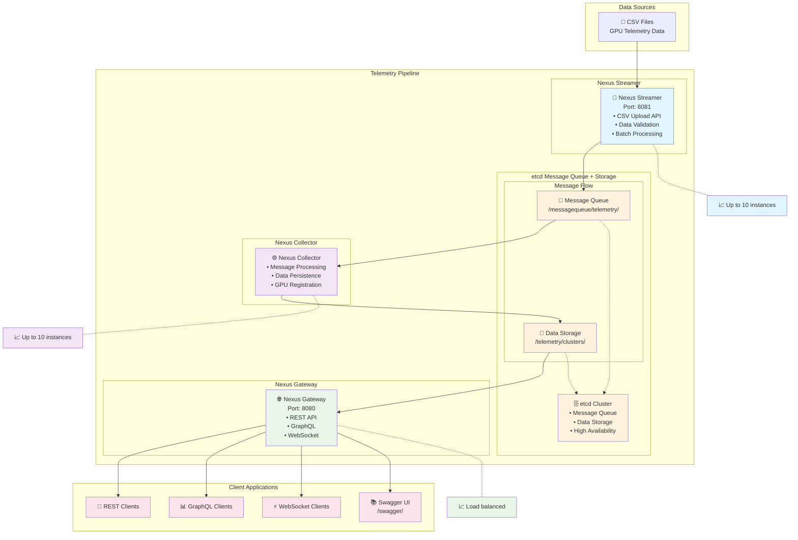

# System Architecture

## Overview

The Elastic GPU Telemetry Pipeline is designed as a distributed system with four main components that work together to ingest, process, and serve GPU telemetry data from AI clusters.

## Core Components

### 1. Telemetry Streamer
**Purpose**: Reads telemetry from CSV files and streams it periodically over the custom message queue.

**Key Features**:
- CSV file parsing and validation
- Batch processing for optimal throughput
- Loop mode for continuous streaming simulation
- Dynamic scaling support (up to 10 instances)
- HTTP endpoint for CSV file uploads

### 2. Telemetry Collector
**Purpose**: Consumes telemetry from the custom message queue, parses and persists it.

**Key Features**:
- Message queue consumption with polling
- Concurrent data processing workers
- Automatic host and GPU registration
- Dynamic scaling support (up to 10 instances)
- Graceful error handling and retry logic

### 3. API Gateway
**Purpose**: REST API exposing telemetry data with auto-generated OpenAPI specification.

**Key Features**:
- RESTful API endpoints per specification
- Auto-generated OpenAPI/Swagger documentation
- Time-based filtering and pagination
- GraphQL and WebSocket support
- CORS and security middleware

### 4. Custom Message Queue
**Purpose**: Messaging system connecting streamers with collectors, implemented using etcd.

**Key Features**:
- Pub/Sub messaging pattern
- Persistent message storage
- Atomic message operations
- Horizontal scaling support
- High availability with etcd clustering

## System Architecture Diagram



## Data Flow

### 1. Data Ingestion Flow
```
CSV Files → Nexus Streamer → etcd Message Queue → Nexus Collector → etcd Storage
```

### 2. Query Flow
```
Client Request → Nexus Gateway → etcd Data Query → Response Formatting → Client Response
```

## Message Queue Design

### etcd-Based Implementation

**Key Structure**:
```
/messagequeue/telemetry/{cluster-id}/{timestamp}_{hostname}_{gpu_id}_{sequence}
```

**Message Format**:
```json
{
  "timestamp": "2024-01-15T10:30:00Z",
  "gpu_id": "0",
  "hostname": "gpu-node-01",
  "uuid": "GPU-12345",
  "device": "nvidia0",
  "model_name": "NVIDIA H100 80GB HBM3",
  "gpu_utilization": 85.5,
  "memory_utilization": 70.2,
  "temperature": 65.0,
  "power_draw": 350.5
}
```

### How It Works (High-Level)

- **Publishing (Streamer → etcd)**: Streamers write JSON messages under `"/messagequeue/telemetry/{cluster-id}/..."` with a TTL lease (e.g., 1 hour) to avoid queue buildup.
- **Consumption (etcd → Collector)**: Collectors list keys by prefix sorted ascending to process oldest-first, then ACK by deleting keys. Use small batches (e.g., 50).
- **Storage (Collector → etcd)**: Processed telemetry is stored persistently under `"/telemetry/clusters/{cluster-id}/hosts/{hostname}/gpus/{gpu_id}/data/{telemetry_id}"`.

### Key Prefixes

- **Queue (temporary)**: `"/messagequeue/telemetry/"`
- **Storage (persistent)**: `"/telemetry/clusters/"`

### Core Features

- **Ordered processing**: Keys encode time (`timestamp`), enabling key-ordered scans.
- **Atomic ops**: Use etcd transactions (Txn) for consume-and-delete.
- **TTL leases**: Messages auto-expire via leases to prevent buildup.
- **Watch notifications**: Collectors can watch the queue prefix for new messages.
- **Distributed coordination**: Optional etcd mutex/leases for exclusive processing.

### Debugging Tips

```bash
# Queue depth (count messages)
etcdctl get --prefix "/messagequeue/" --keys-only | wc -l

# Inspect a few queued messages
etcdctl get --prefix "/messagequeue/telemetry/" --print-value-only | head -5

# Watch incoming messages
etcdctl watch --prefix "/messagequeue/telemetry/"
```

### Configuration (Env Vars)

```bash
ETCD_ENDPOINTS=localhost:2379
MESSAGE_QUEUE_PREFIX=/messagequeue/telemetry
BATCH_SIZE=50
POLL_INTERVAL=5s
MESSAGE_TTL=3600
```

## Scaling Architecture

### Horizontal Scaling (Up to 10 instances each)

**Streamer Scaling**: Multiple streamers can process different CSV files
**Collector Scaling**: Multiple collectors consume from shared message queue  
**Gateway Scaling**: Stateless API servers for easy horizontal scaling

## Performance Characteristics

### Throughput Targets
- **Streamer**: 10,000+ records/second per instance
- **Collector**: 5,000+ records/second per instance
- **Gateway**: 1,000+ API requests/second per instance

### Latency Targets
- **End-to-End**: <100ms for data ingestion to availability
- **API Response**: <50ms for simple queries
- **Message Processing**: <10ms per message
